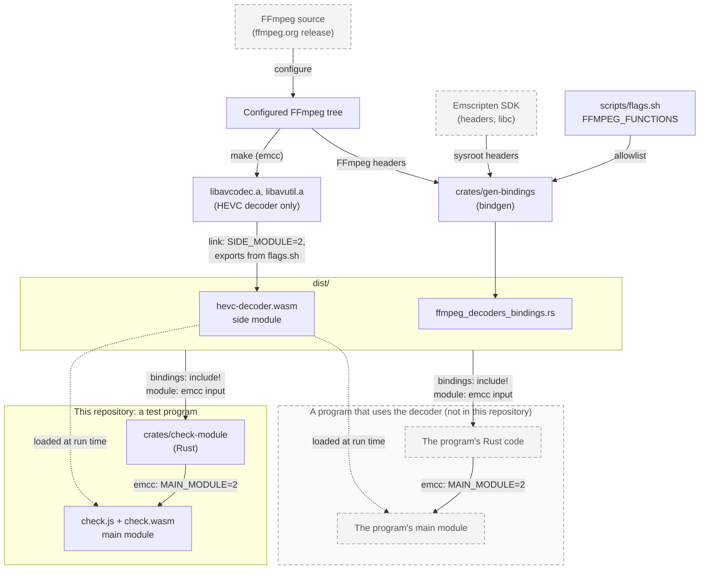

# ffmpeg-decoders-wasm

Single-codec FFmpeg decoders as Emscripten WebAssembly modules. Each codec has
its own set of release assets. The modules are built from the upstream FFmpeg
source release, pinned by version and SHA-256 in `scripts/flags.sh`.

## Modules

| Asset (in `dist/`)            | What it is                            |
| ----------------------------- | ------------------------------------- |
| `hevc-decoder.wasm`           | HEVC decoder, as a side module        |
| `ffmpeg_decoders_bindings.rs` | Rust declarations of the exported API |

`hevc-decoder.wasm` consists of libavcodec and libavutil, linked unmodified. It
contains no code from this repository.

It exports the functions listed in `scripts/flags.sh` (`avcodec_find_decoder`,
`avcodec_open2`, `avcodec_send_packet`, `avcodec_receive_frame`,
`av_frame_alloc` and others). The linker also exports the module's other
default-visibility symbols: FFmpeg-internal `ff_*` and `av_*` symbols, and the
dynamic-linking entry points `__wasm_call_ctors` and `__wasm_apply_data_relocs`.
They are not part of the API, and the bindings do not declare them.

The module is an Emscripten side module. It imports its memory and libc from the
program that loads it. A program links it by naming it on the `emcc` command
line (`-sMAIN_MODULE=2`).

`ffmpeg_decoders_bindings.rs` is generated by `crates/gen-bindings` (bindgen)
from the configured FFmpeg source tree. It declares the structs, constants and
functions of the exported API. Struct layouts and constants are those of wasm32,
from the Emscripten SDK's headers. Function signatures come from the host's
system headers, because bindgen emits no functions for WebAssembly targets. The
module's export list and the bindings derive from one list, so they cannot
disagree.

Emscripten's `errno` values differ from Linux's: `AVERROR(EAGAIN)` is -6.
Callers SHOULD take `libc::EAGAIN` from the target instead of copying the
number.

`crates/check-module` is a minimal consumer: Rust that opens the decoder and
flushes it through the bindings.

## How the pieces link



## Build

```sh
sh scripts/build.sh   # dist/
sh scripts/check.sh   # links crates/check-module with the module, runs it
```

`scripts/build.sh` requires curl, tar with xz, `make`, a C compiler, Rust,
libclang (for bindgen) and Emscripten. `scripts/check.sh` also requires Node and
the Rust target `wasm32-unknown-emscripten`.

## Release

Pushing a tag `v<version>` runs `.github/workflows/release.yml`. It publishes
the files CI built for the tagged commit: the module,
`ffmpeg_decoders_bindings.rs`, `FFmpeg-LGPL-2.1.txt`, `Emscripten-LICENSE.txt`,
`musl-COPYRIGHT.txt`, `BUILD.md` (how to build a replacement) and `SHA256SUMS`.
The module and the bindings carry build-provenance attestations.

## Licence

- Scripts and Rust code: MIT (`LICENSE-MIT`) or Apache-2.0 (`LICENSE-APACHE`),
  at your option.
- Modules: FFmpeg code, LGPL 2.1 or later (`FFmpeg-LGPL-2.1.txt`). A module
  contains no Emscripten runtime or musl code; the program that loads it does.
  `Emscripten-LICENSE.txt` and `musl-COPYRIGHT.txt` cover that code.
